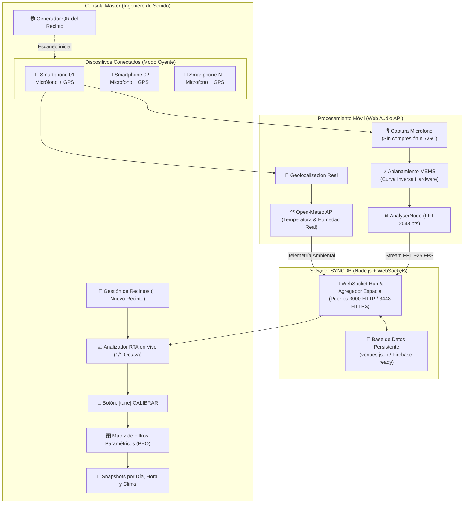
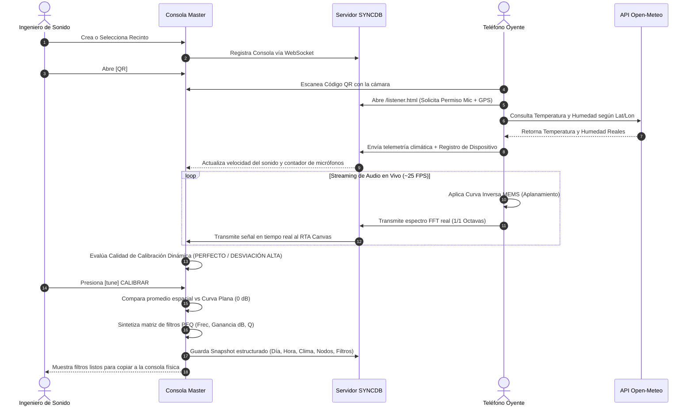

# SYNCDB
### Consola de Calibración Acústica Distribuida en Tiempo Real para Técnicos de Sonido

SYNCDB es una plataforma de telemetría y calibración acústica de precisión diseñada para ingenieros de sonido en vivo (*FOH Engineers*), diseñadores de sistemas electroacústicos y técnicos de recintos. Transforma los teléfonos inteligentes del público o del equipo técnico en una malla de sensores acústicos en tiempo real, eliminando la necesidad de costosos micrófonos de medición estacionarios y resolviendo el problema crítico del cambio acústico provocado por la presencia del público y las variaciones térmicas.

---

## 1. Principios del Proyecto ("Menos es Más")

* **Nombre Unificado**: **SYNCDB** en todas las interfaces, consolas y nodos.
* **Cero Datos Falsos (*Zero Mock Data*)**: El analizador RTA en tiempo real y los cálculos de calibración se alimentan exclusivamente de la señal de audio real capturada por los micrófonos de los dispositivos conectados. Si no hay dispositivos vinculados mediante el código QR, la consola muestra su estado de espera técnico sin inventar curvas.
* **Flujo Inicial de Recintos**: La aplicación inicia permitiendo crear un nuevo recinto con su nombre y capacidad, organizando todas las mediciones y snapshots acústicos de forma aislada por venue.
* **Métricas Claras en Tiempo Real**:
  * **Nivel Promedio (dBA Ponderación A)**: Valor numérico grande e instantáneo con indicador de dispersión espacial.
  * **Estado de Calibración Dinámico**: Evalúa en vivo la desviación espectral respecto a 0 dB (`SIN SEÑAL`, `DESVIACIÓN ALTA`, `CALIBRACIÓN BUENA`, `EXCELENTE`, `PERFECTO`).
  * **Botón de Calibrar**: Minimalista, con icono y acción instantánea sin párrafos explicativos dentro del botón.
* **Historial de Snapshots Estructurado**: Registra snapshots por día, hora, condiciones ambientales (temperatura, humedad, velocidad del sonido, retardo ms/m), dispositivos conectados y matriz de filtros correctivos (PEQ).
* **Modo Oyente Ultralimpio**: Solo el nombre SYNCDB, nombre del recinto, temperatura y velocidad del sonido en tiempo real, vúmetro de dBA Leq y retículo acústico sensible. Cero textos innecesarios para el usuario móvil.

---

## 2. Diagramas de Arquitectura

### A. Flujo General del Sistema



### B. Diagrama de Secuencia: Emparejamiento y Calibración



---

## 3. Fundamentos Físicos y Fórmulas Matemáticas

### A. Velocidad del Sonido (\(c\)) en Función del Clima
En acústica arquitectónica y sonorización en vivo, la velocidad del sonido en el aire varía principalmente con la temperatura ambiente (\(T\) en °C) y, en menor medida, con la humedad relativa (\(RH\) en %):

\[
c \approx 331.4 + (0.606 \times T) + (0.0124 \times RH) \quad [\text{m/s}]
\]

**Impacto en la Calibración de Sonido:**
* Por cada \(1^\circ\text{C}\) de aumento de temperatura (común cuando entran cientos de espectadores a una sala), la velocidad del sonido aumenta aproximadamente \(0.6 \text{ m/s}\).
* Si una torre de retardo (*delay tower*) se ubica a \(30\text{ metros}\) del escenario, un cambio de temperatura de \(10^\circ\text{C}\) altera el tiempo de llegada en más de \(1.5\text{ ms}\), generando **cancelaciones de fase destructivas (filtro de peine)** en la zona de solapamiento.
* El factor de retardo acústico exacto por metro se calcula dinámicamente como:
  \[
  \Delta t = \frac{1000}{c} \quad [\text{ms/m}]
  \]

---

### B. Aplanamiento de la Curva del Micrófono Móvil (MEMS)
Los micrófonos integrados en los smartphones no son micrófonos de medición con respuesta plana; presentan dos anomalías físicas inherentes a su diseño para telefonía:
1. **Filtro de paso alto agresivo por debajo de 80 Hz**: caída de \(-8\text{ dB}\) a \(-14\text{ dB}\) para evitar ruido de viento o manipulación mecánica.
2. **Resonancia de cavidad entre 3.5 kHz y 5 kHz**: pico de \(+3\text{ dB}\) a \(+5\text{ dB}\) debido a la resonancia de Helmholtz en el pequeño puerto acústico del chasis.

Para corregir esta desviación y permitir que un smartphone funcione como un sensor acústico confiable, SYNCDB aplica una **función de transferencia inversa**:

\[
H_{\text{calibrada}}(f) = H_{\text{capturada}}(f) + C_{\text{inversa}}(f)
\]

| Centro de Octava (Hz) | Desviación Típica del Móvil | Compensación Inversa Aplicada \(C_{\text{inversa}}\) |
|---|---|---|
| **31.5 Hz** | \(-14.2\text{ dB}\) | \(+14.2\text{ dB}\) (Refuerzo subgrave) |
| **63 Hz** | \(-8.8\text{ dB}\) | \(+8.8\text{ dB}\) (Compensación de paso alto) |
| **125 Hz** | \(-3.5\text{ dB}\) | \(+3.5\text{ dB}\) |
| **250 Hz - 2 kHz** | \(\approx 0.0\text{ dB}\) | \(0.0\text{ dB}\) (Zona lineal) |
| **4 kHz** | \(+4.8\text{ dB}\) | \(-4.8\text{ dB}\) (Filtro notch anti-resonancia) |
| **8 kHz** | \(-1.5\text{ dB}\) | \(+1.5\text{ dB}\) |
| **16 kHz** | \(-5.4\text{ dB}\) | \(+5.4\text{ dB}\) (Apertura de aire) |

El usuario puede alternar en el teléfono entre **"Raw (Directo)"** y **"Curva Plana"** para comprobar visualmente la nivelación de la señal en tiempo real.

---

## 4. Instrucciones de Ejecución

### Paso 1: Iniciar el Servidor
Ejecuta el servidor:
```bash
node server.js
```
El servidor mostrará en la terminal:
```
======================================================
[SyncDB WASN Console] Servidor iniciado con éxito
> Consola Master (Local):   http://localhost:3000
> Consola Master (LAN):     http://<TU_IP_LOCAL>:3000
> Modo Oyente (Móvil LAN):  http://<TU_IP_LOCAL>:3000/listener.html?venue=VEN-XYZ
> Modo Oyente (HTTPS LAN): https://<TU_IP_LOCAL>:3443/listener.html?venue=VEN-XYZ
======================================================
```

### Paso 2: Crear tu Recinto
1. Abre [http://localhost:3000](http://localhost:3000) en el navegador.
2. Si no hay recintos creados, aparecerá el botón **[ + NUEVO RECINTO ]**.
3. Ingresa el nombre (ej. *"Auditorio Central"*) y haz clic en **"Crear Recinto"**.

### Paso 3: Conectar Teléfonos Móviles
1. Haz clic en el botón superior **`[ QR ]`**.
2. Conecta el teléfono al mismo Wi-Fi y escanea el código QR con la cámara.
3. Toca **"Toca para Conectar"** y autoriza los permisos de micrófono y ubicación.
4. En la Consola Master verás el contador actualizarse a **"1 NODO"** y el espectrograma RTA en vivo dibujando la curva real capturada en color verde fósforo.

### Paso 4: Calibrar y Guardar Snapshot
1. Con los micrófonos activos, presiona el botón **`[tune] CALIBRAR`**.
2. El sistema evaluará el estado acústico, sintetizará los filtros paramétricos y guardará automáticamente el snapshot con día, hora y variables de clima en la pestaña **"3. Historial Calibraciones"**.
